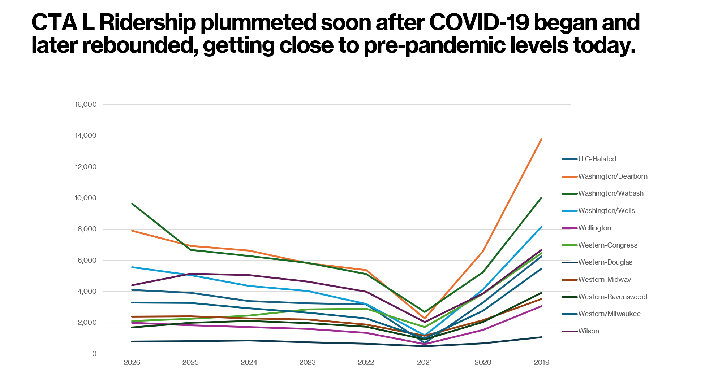
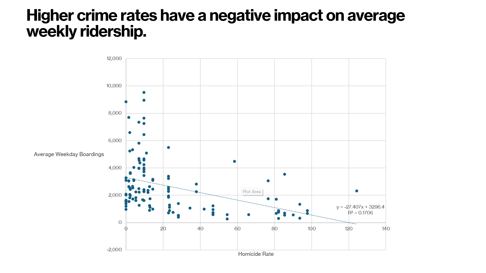
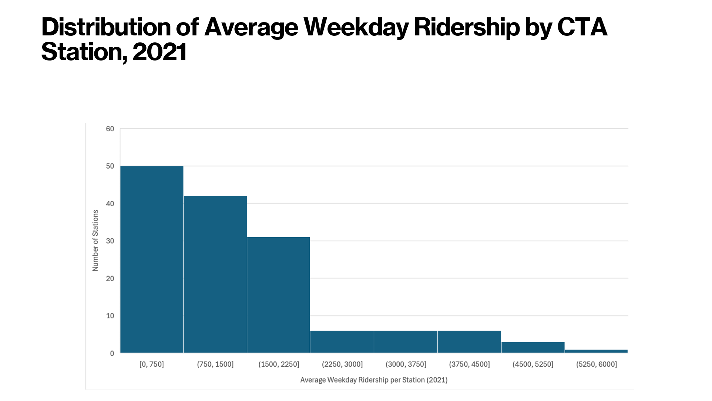
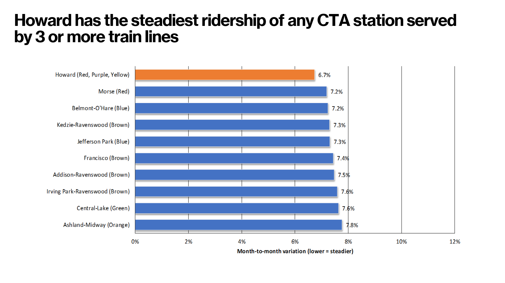

## Team

This project was completed with [Rhishab Dahal](https://sites.google.com/view/rhishabdahal/home?pli=1&authuser=0), [Dennis Morrison](https://dennismorrison06.github.io/index.html), [Reid Banks](https://crbanks07.github.io/), [Stafford Waller](https://swaller06.github.io/) and Me.

## About the Data Set

Our data set is a CTA ridership spreadsheet with average weekday ridership for each CTA "L" station, recorded month by month from 2019 through July 2026. It covers 144 stations and lists the train lines that stop at each one, which let us compare stations by size, service, and how their ridership changed after COVID-19. For the crime question, we paired the ridership data with the 2024 homicide rate of each station's Chicago community area.

## Question 1: How has Ridership on the CTA Rebounded After the COVID-19 Pandemic?

To answer that question a time‑series graph was built showing average weekday CTA ridership at selected stations on each of the eight CTA L lines. The horizontal axis displays years in the data each year linked to the month of March so every year is compared at the point in time. The vertical axis displays average weekday CTA ridership, at each station. When CTA ridership is plotted over time the graph shows how CTA ridership fell during the pandemic and how much of that fall has come back.

## Question 2: How much does the crime rate affect ridership?

We asked whether stations in higher-crime neighborhoods see fewer riders. We plotted 124 Chicago rapid transit stations, pairing each one's 2024 average weekday boardings with the 2024 homicide rate of its community area, and left out 19 suburban stations that the city's crime data doesn't cover. Our scatter plot's downward-sloping trendline shows that every 10 additional homicides per 100,000 residents goes with roughly 270 fewer daily boardings, and the pattern holds even with the Loop set aside. Higher-crime neighborhoods tend to have lower ridership, but crime explains only a modest share of the differences between stations, so this is an association and not proof that crime drives riders away.

## Question 3: What is the statistical distribution of ridership in 2021?

The distribution was determined by analyzing the weekday ridership of each CTA station in 2021. The average of each station’s 12 monthly weekday ridership values was calculated in Excel using the function, which gave one 2021 value per station. A histogram was then created from these values effectively grouping stations into bins based on their weekday ridership. Most stations fall in the bins with 64 of the 144 averaging fewer than 1,000 weekday riders while a small number of stations average more than 4,800. The mean (about 1,431 riders) is higher than the median (about 1,121 riders). The skewness of about 1.54 confirms the long tail, to the right. Because 2021 was still affected by the COVID‑19 pandemic these figures reflect ridership.

## Question 4: Which station has the most constant movement with the lowest wait time?

We asked which CTA station has the most constant flow of riders while still getting frequent service, since riders want predictable crowds and short waits. As industrial engineering students, we also saw this as a flow question: steady arrivals and frequent service keep lines short, on a platform or a production line. In Excel, we looked at stations served by 3 or more train lines, since more lines means more trains. We counted lines with LEN and SUBSTITUTE, used INDEX and MATCH to pull 24 months of weekday ridership (August 2024 to July 2026) to avoid the COVID drop, and divided STDEV.S by AVERAGE to measure month-to-month variation, where a lower percentage means steadier ridership. For our assertion-evidence slide, we sorted stations from steadiest to least steady in a horizontal bar chart, colored Howard's bar orange, added each station's line count to its label, and added percentage data labels. Howard varies only 6.7%, while Clark/Lake (14.8%) and Washington/Wabash (23.4%) swing much more, so Howard has the most constant flow with three train lines.
